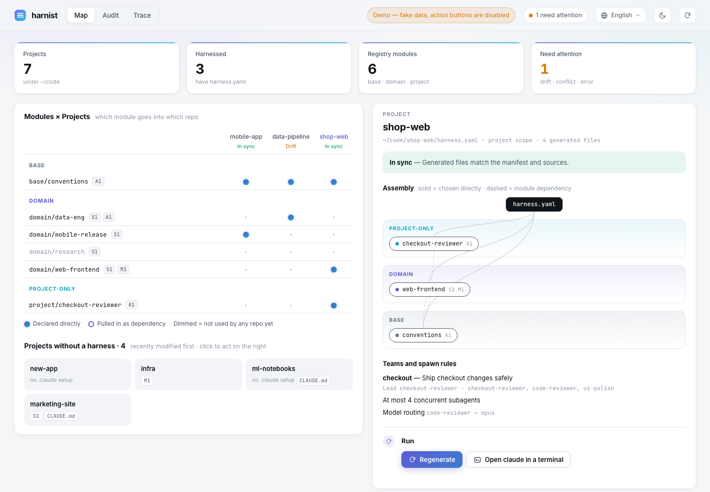
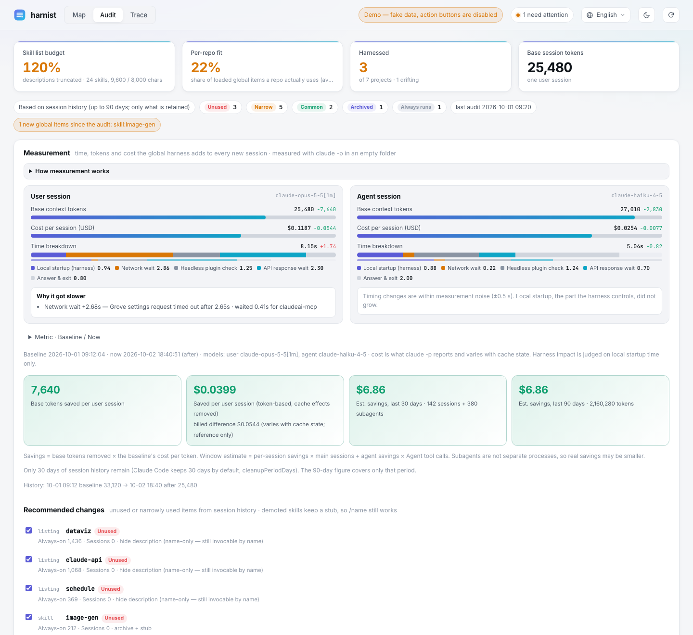
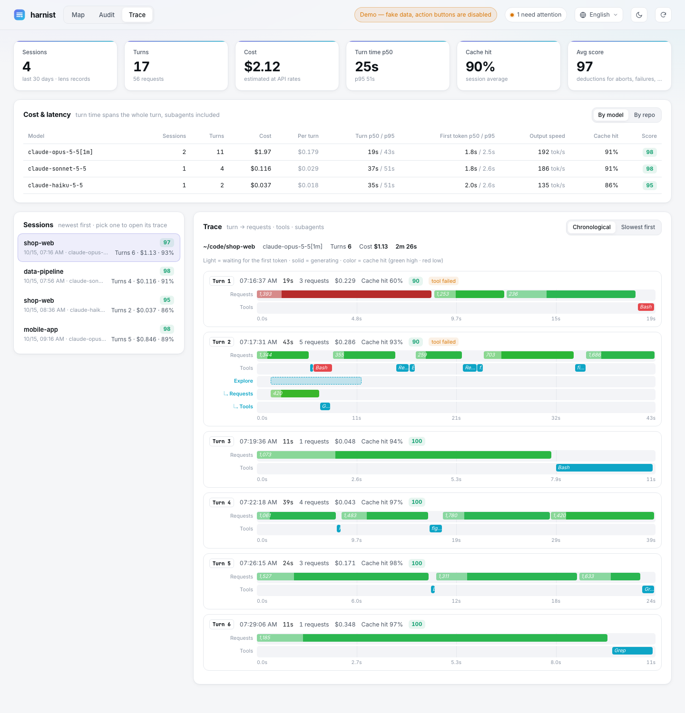
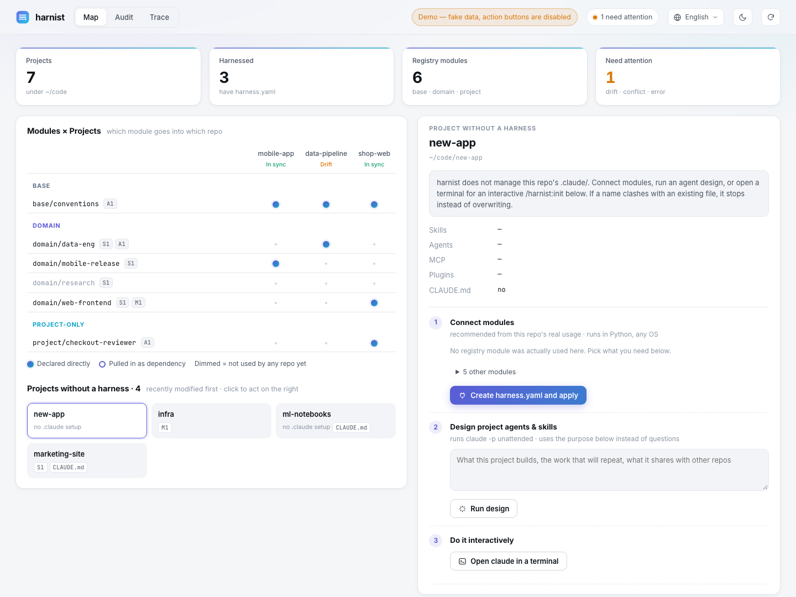

<div align="center">

# harnist

**Keep lightweight subagents from getting dumber — load only the skills, plugins and MCP servers each project needs.**

A Tuist-style module manager and dashboard for [Claude Code](https://claude.com/claude-code) harnesses.

[한국어](README.ko.md) · [Quick start](#quick-start) · [Features](#features) · [How it works](#how-it-works)



</div>

## Why

Every global skill, agent, plugin and MCP server you install rides along in **every** Claude Code session, whether or not that repo needs it. Three problems follow:

- **Lightweight subagents see truncated skill descriptions.** Claude Code shows the model a list of skill descriptions, budgeted by the context window. 1M-context sessions have room. 200k models such as Haiku and Sonnet — the ones you typically spawn as subagents or `claude -p` workers — get about 8,000 characters. Past that, descriptions are cut and the subagent picks the wrong skill or misses the right one. Claude Code logs this as `Skill listing over budget`. On the author's machine the list was 89 skills and 33,688 characters, four times the budget.
- **Most of what is loaded is irrelevant.** Across 17 repos, a session used on average only 1 in 4 of the global items it carried.
- **Copies drift.** Skills promoted from one repo to `~/.claude` by hand slowly diverge from their source.

harnist treats your harness like a modular codebase. Shared things live in a **registry** as modules, each repo declares what it needs in a `harness.yaml`, and `.claude/` is **generated**. A dashboard shows what every repo actually uses, recommends what to move out of the global scope, and measures the effect.

On the author's machine, archiving unused user items and hiding the descriptions of 29 unused built-in and plugin skills brought a Haiku session's skill list back inside the budget — every skill still listed by name. Token and cost savings come along, but they are the side effect, not the point.

## Quick start

```bash
git clone https://github.com/Dominic-DK/harnist && cd harnist
pip install pyyaml            # the only dependency (or: uv run harnist.py ...)
python3 harnist.py demo --open
```

`demo` builds a fake workspace in a temp folder — projects, a registry, a global `~/.claude`, session history and measurements — and opens the dashboard read-only. Nothing on your machine is touched.

To use it for real:

```bash
python3 harnist.py view --open      # your repos under ~/Documents/github (HARNIST_ROOT to change)
```

The first `view` runs one baseline measurement (two `claude -p` calls, see [Measurement](#measurement)).

### As a Claude Code plugin

This repository is also a plugin marketplace:

```
/plugin marketplace add Dominic-DK/harnist
/plugin install harnist@harnist
```

To record what each session loads and uses, add `/plugin install lens@harnist` too — see [Trace](#trace--lens-a-langfuse-lite-for-claude-code).

The plugin adds slash commands — `/harnist:audit`, `/harnist:init`, `/harnist:sync`, `/harnist:promote`, `/harnist:view` — and a tiny SessionStart hook. The commands are user-invoked only, so they add **no always-on context**. The hook stays silent unless something needs attention, and does nothing in headless or SDK runs. The engine runs from the marketplace clone, so no separate checkout is needed.

## Features

### Map — what goes where

The **Modules × Projects** matrix shows which module each repo uses: a filled dot means declared directly, a ring means pulled in as a dependency. Click a project to see its layered assembly (project → domain → base), teams and spawn rules. Repos without a `harness.yaml` are listed underneath.

### Audit — slim the global scope by real usage



harnist reads your Claude Code session history (`~/.claude/projects/*.jsonl`) and counts which skills, agents, plugins and MCP servers each repo actually called. Every global item gets a verdict:

| Verdict | Meaning | Suggested action |
| --- | --- | --- |
| Unused | never called | archive to the registry, remove from global |
| Narrow | used in 1–2 repos | archive and connect only to those repos |
| Common | used in 3+ repos | keep global |
| Archived | already moved out, a stub remains | — |

Tick the recommendations and press **Apply selected and re-measure**. Archiving never deletes anything:

- **Skills** leave a **stub** in `~/.claude/skills/<name>` with zero always-on cost. `/name` still works: the stub loads the archived copy and offers to connect it to the current repo or restore it globally.
- **Originals** go to `.trash/`.
- **Plugins** are disabled at user scope. **MCP servers** are removed at user scope, with their config kept in a module.

#### Built-in and plugin skills

Most of what remains after slimming your own skills comes from Claude Code's built-in skills and from plugins. `harnist skills` lists every skill the model actually receives — read from the session transcript, with origin, description length and real calls. Unused built-in and plugin skills are recommended for `skillOverrides: name-only`, which hides the description but keeps the name, so the skill can still be invoked. `harnist skills --name-only <skill> ...` applies it (settings are backed up first) and `--reset` undoes it.

The top tiles are the numbers that matter:

- **Skill list budget**: is the model seeing full descriptions?
- **Per-repo fit**: the share of loaded global items each repo actually uses.
- **Harnessed projects**: how many repos are managed, and how many are drifting.
- **Base session tokens**

### Measurement

`claude -p` runs once as a user session (your default model) and once as an agent session (haiku) in an empty folder, so only the global load is measured. The debug log splits time into five segments:

| Segment | What it covers |
| --- | --- |
| Local startup | settings, plugins, hooks, local MCP — the only part the harness controls |
| Network wait | remote requests such as account settings and connectors |
| Headless plugin check | runs only under `claude -p` |
| API response wait | server speed |
| Answer & exit | output length |

When a segment gets slower than the baseline, the cause found in the log is shown (for example *“Grove settings request timed out after 2.65 s”*), so network noise is never mistaken for a harness regression.

Savings are computed as *base tokens removed × the baseline's cost per token*, not as the billed difference, because back-to-back runs warm the cache and make billed costs look lower than they are.

### Trace — lens, a Langfuse-lite for Claude Code



Audit counts what sessions *called*. To see what a session actually *carried*, and where its time and money went, install the second plugin in this marketplace, **lens**. It is a Claude Code [mod](https://code.claude.com/docs/en/plugins/mods/overview) — event handlers that run inside the session — so it reads what the model really received instead of estimating it.

```
/plugin install lens@harnist
```

For every session it writes `~/.claude/lens/<session>.jsonl`, with structure and sizes only and never message text:

- **Loaded**: the `/context` breakdown per skill, memory file, MCP server (loaded vs. deferred) and agent, system-prompt sections, and text injected by hooks.
- **Used**: tool calls with timing and failures, skill expansions, subagents.
- **Per request**: cache read and write, time to first token, output speed, and why the cache broke — first request, model switch, idle for more than five minutes, or a changed prompt.
- **Per turn**: a score that starts at 100 and drops for aborts, errors, failed or repeatedly failing tools, denials, permission prompts and compaction, plus the turn's cost from Claude Code's own running total.

Inside Claude Code, `/lens` opens a pane (overview, load, activity; English or Korean) and a line under the prompt shows the live cache hit, how long the cache stays warm, and context use. `/lens review` — or asking for the **lens-review** skill — has Claude read the numbers through the plugin's `report` tool, propose fixes in priority order, and apply only the ones you approve.

The **Trace** tab of `harnist view` turns the records into:

- **Cost & latency** per model or per repo: turn time p50/p95 (subagents included), time to first token p50/p95, output speed, cache hit, score, and cost per turn.
- **A waterfall per turn**: requests colored by cache hit with the wait for the first token shaded, tool calls with failures in red, and each subagent on its own lane.

**Prompt A/B experiments.** Put experiments in `~/.claude/lens/experiments.json` — replace or drop a system-prompt section by name, or append one:

```json
{ "experiments": [ { "id": "short-tone", "op": "replace", "section": "tone", "text": "Be brief." } ] }
```

Each session is assigned A (original) or B (variant) from a hash of its id, so a session never changes arms and its cache stays intact. `/lens exp` shows the arms of the current session, and the Trace tab's *By experiment* view compares score, cache hit, turn time and cost per variant.

From the CLI, `harnist lens` lists items that were loaded but never used (ranked by unused sessions × tokens) and `harnist lens --stats` prints the cost and latency table. `harnist usage --json` gains a measured `lens` field for each global item.

### New projects — connect what you will actually use



For a repo without a harness, the right-hand panel offers three steps:

1. **Connect modules.** harnist recommends registry modules from that repo's real usage and skips anything already enabled globally. Applying writes `harness.yaml` and generates `.claude/`. This step is pure Python and works on any OS.
2. **Design project agents & skills.** Describe the project and harnist runs `claude -p` unattended with the `/harnist:init` procedure. It designs only what no module covers, stores the result as project modules in `.harnist/modules/`, and streams the log into the panel.
3. **Do it interactively.** Opens a terminal with `claude` in that folder: Terminal on macOS, Windows Terminal or cmd on Windows, and the usual emulators on Linux. If none can be opened, it shows the command to copy.

### Child profiles — launch claude -p and codex exec under one contract

A headless child receives an environment its parent can't see. A `claude -p` child inherits the user's hooks, plugins, MCP servers and permission mode. A `codex exec` child doesn't read CLAUDE.md and starts in a read-only sandbox. An inherited Stop hook can even replace the return value. `profiles:` declares, vendor-neutrally, what the child should receive.

```yaml
profiles:
  review:                       # built in — independent review
    write: none                 # none | workspace
    network: false
    inherit: project            # project = cut the user layer | user = inherit as-is
    tools: [read, search]       # read search edit shell web
    output: schema              # schema | text
    schema: .handoff/review.schema.json
  delegate:                     # built in — delegated execution
    write: workspace
    tools: [read, search, edit, shell]
    shell_allow: [git status, git diff, python3 run_tests.py]
```

`harnist profile compile review --for codex` turns the declaration into that CLI's flags and grades each property **enforced / approx / unenforced**. The same declaration holds differently per vendor. Codex can't enforce a shell allowlist (exec forces approval never), and Claude can't block network use by allowed shell commands. `harnist profile probe review` launches the child once with the compiled flags. It judges from file existence and tool output in the trace, never from the child's own report. Each verdict is PASS, FAIL (contradicts the declaration), gap (a limit compile already reported), or n/a (no way to observe on that vendor). It exits 1 on any FAIL. A probe runs one real session per vendor, on haiku for Claude and reasoning effort low for Codex unless the profile names a model.

A profile can also pick the mods its child loads. `mods: [lens, runtime]` compiles to `--plugin-dir` for each (bundled names resolve to this repo's folders, anything else is a path), and `runtime: roles.json` hands that child its own per-role subagent rules through `HARNIST_RUNTIME_CONFIG`. Add `agent` to `tools` so the child can spawn subagents at all; compile warns when `runtime` is set without it. So a worker launched for research can cut user plugins, carry only lens and runtime, and fan out to Explore subagents that receive no skill list, no MCP notes and no CLAUDE.md. Codex has no mods, so both keys grade as unenforced there.

Route the child through a model-API logging proxy (for example `teamclaude server --log-to DIR` plus `ANTHROPIC_BASE_URL`) and pass `--request-log DIR`, and the probe also judges from the requests the model actually received. It checks whether the user CLAUDE.md was loaded, whether auto-memory instructions were injected, and whether the tool schemas match the declaration. None of these show in the trace. Note that Claude's auto memory is not turned off by `--setting-sources project`, so `persist: false` also emits `CLAUDE_CODE_DISABLE_AUTO_MEMORY=1`. This too was confirmed from the request log.

Codex works the same way. With `--codex-base-url URL` the probe adds `-c openai_base_url=…`, which Codex follows even in ChatGPT sign-in mode. The probe then judges whether the `sandbox_mode` in the permission instructions the model received matches the declaration (`prompt.sandbox`), and whether user skills or MCP servers were loaded (`prompt.user_skills`, `prompt.user_mcp`). `--ignore-user-config` alone still loaded `~/.agents/skills`, so `inherit: project` also emits `-c skills.include_instructions=false`.

### Subagents by role — the runtime mod

Every subagent normally receives the same skill list, MCP notes and CLAUDE.md as the main session. `roles:` says what each subagent type actually needs, and the [runtime mod](runtime/README.md) cuts the rest per subagent, refuses banned spawns and blocks banned tools.

```yaml
spawn:
  max_parallel_agents: 3      # now enforced, not just written down
  deny: [Plan]
roles:
  Explore:         {skills: [], mcp: [], memory: false, deny_tools: [Bash], model: haiku}
  general-purpose: {skills: ["memory-bank:*"], mcp: [], memory: [/CLAUDE.md]}
```

A module can add `roles:` too, naming the roles its skills are for, so the list starts from what is needed. Lists merge across modules and the manifest, `memory` keeps the widest choice, and two different models for one role is an error. `harnist generate` writes `.claude/harnist-runtime.json` and enables `runtime@harnist`. Repos without `roles:` or `spawn.deny` are unchanged.

Measured on this repo (`runtime/eval/run.py`, 5 + 5 concurrent sessions): subagent first requests shrank 28–32%, everyday answers stayed 25/25, and cost per run fell about a quarter. What a role loses is what you cut. Asked for it, the subagent answers "none" or "unknown" instead of inventing something.

### Ten languages

The dashboard speaks English, 한국어, 日本語, 中文, Español, Français, Русский, हिन्दी, Deutsch and Português. Pick one from the top-right menu, or link with `?lang=ja`. The CLI follows `HARNIST_LANG` (`en` or `ko`) and falls back to your system locale.

## How it works

```
registry/                          shared modules (yours — gitignored, or ~/.harnist/registry)
  base/conventions/module.yaml     layer: base | domain | project
  domain/web-frontend/module.yaml  skills, agents, plugins, mcp, settings, claude_md, rewrites
<repo>/harness.yaml                which modules this repo uses (+ spawn rules, teams, mirror)
<repo>/.harnist/modules/project/   project-only modules, promotable to the registry
<repo>/.claude/  CLAUDE.md block   generated — do not edit by hand
```

| Tuist | harnist |
| --- | --- |
| `Project.swift` | `harness.yaml` |
| modules and layer rules | `registry/<layer>/<name>/module.yaml`. A lower layer may not depend on a higher one |
| `tuist generate` | `harnist generate` → `.claude/`, `.mcp.json`, a managed `CLAUDE.md` block |
| `Package.resolved` | `harness.lock` — content hashes of modules and marketplace commits |
| `tuist graph` | `harnist graph` and the dashboard |

A module can point at another repo's `.claude/` as its `source`, so the original stays the single source of truth and harnist copies it with path rewrites. Set `mirror: [AGENTS.md]` to write the same rule block for agents that do not read `.claude/`, such as Codex.

### Safety

- Every generated file is hashed in a ledger. harnist refuses to overwrite files it did not create (`--adopt` to take ownership) or files edited by hand (`--force`), and writes nothing if any conflict exists.
- `CLAUDE.md` is only touched between `<!-- harnist:begin -->` and `<!-- harnist:end -->` markers on their own lines.
- It never writes through symlinks (for example `~/.claude/skills/x → ~/.agents/skills/x` shared by other agents). Use `links: skip` to leave those to the tool that owns them.
- Archiving refuses content that looks like secrets and skips `.env` and key files. MCP configs with `env` or `headers` must be moved by hand.
- The dashboard binds to `127.0.0.1`, checks the `Host` header, and requires a per-run token on every action.

## CLI

```
harnist demo [--open]                             fake workspace, read-only dashboard
harnist view [--open] [--no-baseline]             dashboard for your repos
harnist list | scan                               registry modules · module usage per repo
harnist init [dir] --modules base/... domain/...  new harness.yaml
harnist generate [-m harness.yaml] [--dry-run] [--frozen] [--adopt] [--force]
harnist check                                     drift and lock check (exit 1 on drift)
harnist attach|detach <module> [repo]
harnist promote project/<x> --to domain/<x>       project module → shared registry
harnist usage [--json]                            per-repo usage of global items
harnist demote skill:<x> --to domain/<x> [--attach repo ...] [--dry-run]
harnist recall skill:<x> --attach . | --global    bring an archived skill back
harnist skills [--name-only S ...] [--reset S ...] every skill the model receives, and hiding unused descriptions
harnist bench                                     measure startup time, base tokens and cost
harnist lens [--days N] [--stats] [--json]         lens records — loaded but unused items, or cost and latency
harnist audit [--mark]                            record the current global state as audited
harnist profile list | compile <name> | probe <name> [--for claude|codex] [--format report|shell|json]
                                                  child profiles — compile flags with enforcement grades, probe that they hold
```

## Compatibility

| | macOS | Linux | Windows |
| --- | --- | --- | --- |
| Engine, dashboard, module apply | ✓ | ✓ | ✓ (Python 3.10+, pyyaml) |
| `claude -p` design and measurement | ✓ | ✓ | ✓ (needs the claude CLI) |
| Open a terminal | Terminal | first available emulator | wt or cmd |
| SessionStart hook | `sh` launcher picks python3, python or py | same | Claude Code runs hooks through Git Bash |

## Limits

- Without `roles:` or `spawn.deny`, spawn rules other than model routing end up as prompt text in `CLAUDE.md` and are not enforced. With them, the runtime mod enforces them, but only where mods run (Claude Code 2.1.287+, not organization-managed installs).
- The lock detects marketplace drift but cannot pin a plugin version.
- Usage counts only explicit calls in retained session history. Claude Code keeps 30 days by default (`cleanupPeriodDays`).
- `skillOverrides` values (`name-only`, `off`) and the skill-list budget were observed in Claude Code, not documented.
- Telling headless runs apart relies on `CLAUDE_CODE_SESSION_ATTENDED` and `CLAUDE_CODE_ENTRYPOINT`. These were observed, not documented.
- lens sees only the sessions it was loaded in, and needs Claude Code 2.1.287 or later. Where an organization manages Claude Code, prompt-level events (system-prompt sections, injected text, skill expansions) do not reach plugins a user installs.
- lens costs are Claude Code's estimate at API rates; on a subscription they are not your bill. The cache TTL (five minutes or one hour) is not exposed, so lens assumes five minutes until a cache survives a longer gap.
- CLI output and the generated `CLAUDE.md` block are in English, or Korean when `HARNIST_LANG=ko` or a Korean system locale is set. Slash-command instructions are in English; Claude answers in your language either way.

## Development

```bash
python3 -m unittest tests.test_harnist      # 74 tests
claude plugin test lens                     # lens mod tests
python3 harnist.py demo --dir /tmp/harnist-demo
```

## Acknowledgements

- **[Tuist](https://github.com/tuist/tuist)** — the project generator that made modular iOS codebases manageable. Instead of hand-editing an `.xcodeproj`, you describe targets and their dependencies in a `Project.swift` manifest, keep features, core and shared code in layered modules, and let `tuist generate` produce the project. harnist borrows exactly that shape: a manifest per repo, layered modules with dependency rules, generated output instead of hand edits, a lock file, and a dependency graph.
- **[revfactory/harness](https://github.com/revfactory/harness)** — the Claude Code plugin that reads a project and designs a team of agents and skills for it. `/harnist:init` follows the same idea, then keeps the result as modules connected to a shared registry so other repos can reuse them.

## License

MIT
